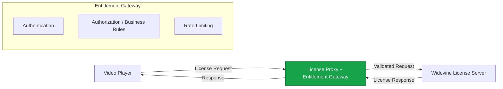
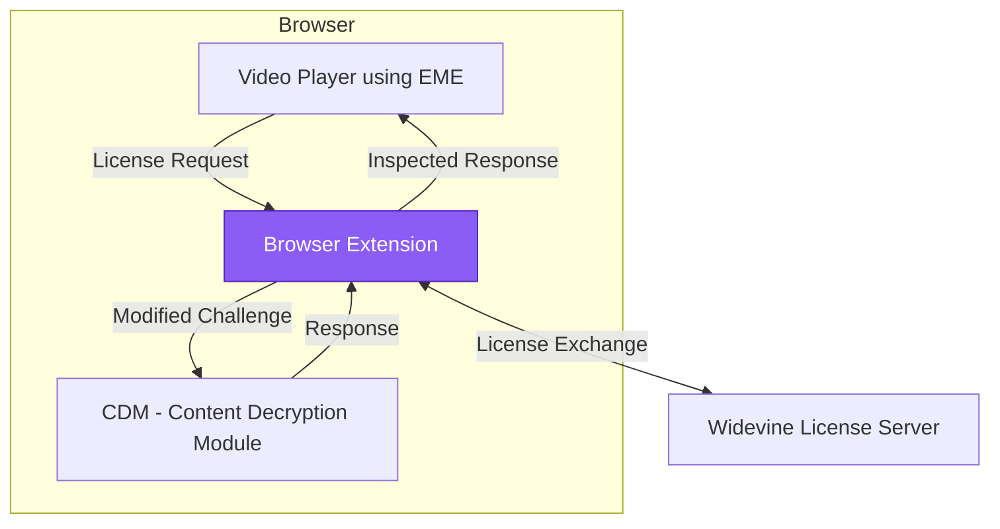

# Widevine License Proxy Techniques

> Structured list of techniques for proxying Widevine license requests, with architecture diagrams (Mermaid) and notes. Formatted for Obsidian.

## Context

This note builds on research into free/open-source HLS DRM relay solutions (such as **MediaFlow Proxy** for ClearKey) and extends it to **Widevine** license proxying.

**Key Difference from ClearKey**:
- ClearKey allows more feasible server-side decryption options.
- Widevine relies on a secure client-side **CDM** (Content Decryption Module). Most "proxies" are intelligent forwarders or interceptors.

---

## 1. Simple Reverse Proxy Forwarding (Most Common & Recommended)

The player sends license requests to your proxy, which forwards them to the real Widevine license server.

```mermaid
graph LR
    A[Video Player / Client<br/>Shaka / video.js / ExoPlayer] -->|License Request (POST)| B[License Proxy Server<br/>Node.js / nginx / Cloudflare]
    B -->|Forward Request| C[Widevine License Server<br/>Google or Provider]
    C -->|License Response| B
    B -->|License Response| A
    
    classDef player fill:#3b82f6,stroke:#1e40af,color:white
    classDef proxy fill:#22c55e,stroke:#15803d,color:white
    classDef server fill:#f97316,stroke:#c2410f,color:white
    class A player
    class B proxy
    class C server
```

**Typical Implementations**
- Node.js + Express (example: WINOFFRG/widevine-license-proxy-server-nodejs)
- nginx / Caddy reverse proxy
- Go minimal proxy (easonlin404/license-proxy)
- Cloudflare Workers

**Player Configuration**: Simply point the `licenseServer` URL in your player config to your proxy endpoint.

**Risk Level**: Low when used for content you control.

---

## 2. Entitlement / Business Logic Gateway Proxy

Extends the simple proxy with authentication, authorization checks, and business rules **before** forwarding the request.



**Common in**: Subscription video platforms and enterprise streaming setups.

---

## 3. Header & Request Manipulation Proxy

Focuses on modifying or injecting HTTP headers, adding custom tokens, or intelligent routing.

Often combined with techniques 1 or 2.

**Risk Level**: Low to Medium.

---

## 4. Client-Side / Browser EME Interception

A browser extension or injected script intercepts and can modify Widevine EME messages (challenges and responses) inside the browser.

**Notable Example**: DevLARLEY/WidevineProxy2



**Risk Level**: Higher — modifying DRM messages can raise anti-circumvention and ToS concerns.

---

## 5. Official / Certified Proxy Approaches

Google provides a **Proxy SDK** for building compliant license proxies in front of their Cloud License Service. This follows the entitlement gateway pattern with formal qualification.

Recommended for production use cases.

---

## 6. Advanced Modification & Remote CDM Techniques

Includes deep challenge rewriting, token stripping, key extraction from responses, and remote/emulated CDM setups.

**Risk Level**: High. Frequently associated with unauthorized access scenarios.

---

## Recommended Combined Setup (HLS + Widevine)

For a complete streaming proxy solution:

- Use **MediaFlow Proxy (Light)** or similar for HLS manifest + segment proxying (excellent for ClearKey and general HLS rewriting)
- Use a separate simple reverse proxy (Technique #1 or #2) specifically for the Widevine license acquisition endpoint

These two components complement each other well.

---

## References & Resources

**GitHub Repositories**
- [WINOFFRG/widevine-license-proxy-server-nodejs](https://github.com/WINOFFRG/widevine-license-proxy-server-nodejs)
- [DevLARLEY/WidevineProxy2](https://github.com/DevLARLEY/WidevineProxy2)
- [easonlin404/license-proxy](https://github.com/easonlin404/license-proxy)
- [mhdzumair/mediaflow-proxy](https://github.com/mhdzumair/mediaflow-proxy) (for ClearKey / HLS side)

**Official**
- Google Widevine documentation (Proxy SDK)

**Legal Note**: Always ensure you have proper rights and comply with all applicable laws and service terms before implementing any proxy solution.

---

*This note is part of the widevine-license-proxy-notes repository.*